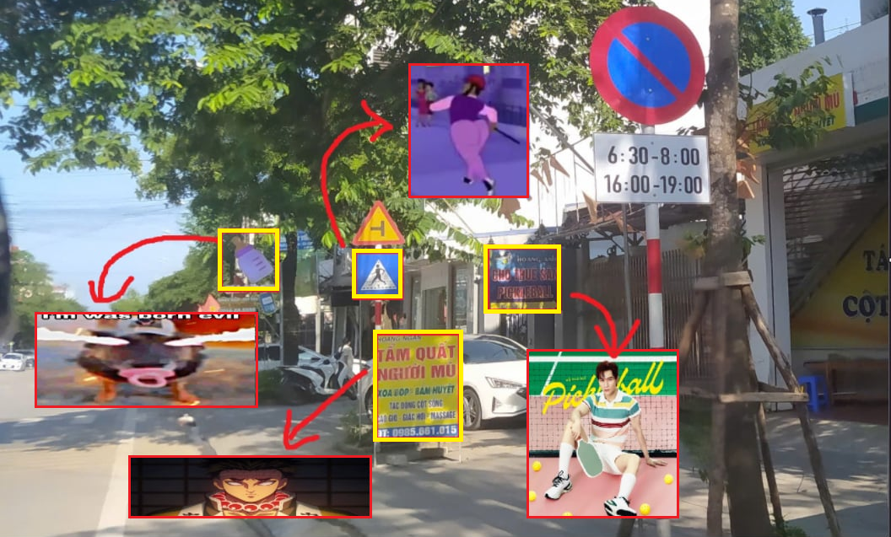

# UTCI-VISION — Hệ thống nhận diện biển báo giao thông Việt Nam



Repo: **https://github.com/HoanBuCon/UTCI-Vision**  
Trello: **https://trello.com/b/BcQ48yqk/faketime-traffic-signs-cant-detect**

Đồ án môn **Thị giác máy tính**. Web app nhận diện **32 loại biển báo** từ ảnh, video và webcam realtime,
đọc **giá trị số** (km/h, m, T) và **chữ tiếng Việt** trên biển / biển phụ. Demo chạy bằng **Docker**.

```
Frame ─► [CV] đánh giá chất lượng → tăng cường khi cần
      ─► [DL] YOLO11 (fine-tune) phát hiện + phân loại 32 lớp     ← mỗi frame
      ─► [CV] tracking Kalman + IoU, bỏ phiếu nhãn                ← mỗi frame
      ─► theo track, chạy nền:
            [CV+ML] đặc trưng màu/hình dạng → LightGBM xác minh
            [CV+DL] vùng số / vùng chữ / biển phụ → VietOCR → regex hợp lệ hoá số + từ điển sửa chữ
      ─► FastAPI (REST/WebSocket) ─► React
```

## Tài liệu

| Tài liệu | Nội dung |
|---|---|
| [docs/00_PHUONG_AN.md](docs/00_PHUONG_AN.md) | Phương án kỹ thuật đã duyệt |
| [docs/01_TECHSTACK.md](docs/01_TECHSTACK.md) | Công nghệ, phiên bản, cổng, Makefile, cấu trúc mã nguồn |
| [docs/02_SRS.md](docs/02_SRS.md) | Đặc tả yêu cầu (living SRS) |
| [docs/03_SPRINT_PLAN.md](docs/03_SPRINT_PLAN.md) | Kế hoạch 6 sprint (sinh từ `planning/sprint_plan.json`) |
| [docs/quy_uoc.md](docs/quy_uoc.md) | Quy ước Git: nhánh, commit, Pull Request |
| [docs/adr/](docs/adr/) · [docs/data/DATA_CARD.md](docs/data/DATA_CARD.md) · [docs/models.md](docs/models.md) | Quyết định kiến trúc · dữ liệu · trọng số |

## Bắt đầu

```bash
git clone https://github.com/HoanBuCon/UTCI-Vision.git && cd UTCI-Vision
make env            # tạo .env — mọi cổng là cổng custom (API 18100, web 18080, Vite 15173, Jupyter 18888)
make venv           # rồi TỰ cài PyTorch theo GPU: https://pytorch.org/get-started/locally/  (torch >= 2.4)
make install        # thư viện dùng chung (đã khoá phiên bản, không chứa torch) + VietOCR + package
make check-env
make ci             # lint + test + notebook khớp template + build web + compose hợp lệ
make help           # toàn bộ lệnh DevOps
```

**Makefile chỉ dùng cho DevOps** (môi trường, CI, Docker); Windows chạy trong Git Bash. Chạy dev trực tiếp — cổng vẫn lấy từ `.env`:

```bash
python -m utci_vision.api --reload                 # FastAPI :18100
cd web && npm run dev                              # Vite :15173, proxy /api
jupyter lab --config jupyter_server_config.py      # JupyterLab :18888
```

## Fine-tune — chỉ bằng notebook

| Nền tảng | Notebook |
|---|---|
| Máy cá nhân | [notebooks/train/train_local.ipynb](notebooks/train/train_local.ipynb) |
| Google Colab | [notebooks/train/train_colab.ipynb](notebooks/train/train_colab.ipynb) |
| Kaggle | [notebooks/train/train_kaggle.ipynb](notebooks/train/train_kaggle.ipynb) |

YOLO11 được **fine-tune** từ trọng số pretrained COCO (hoặc checkpoint của nhóm), không train lại từ đầu; bộ xác minh LightGBM
được fit trên đầu ra của YOLO; VietOCR dùng pretrained để đọc cả số và chữ. Ba notebook sinh từ `notebooks/train/_template.py` (`python scripts/build_notebooks.py`).
Sau khi chạy: `python scripts/import_run.py <thư-mục-run> --promote` → `models/current/` + `experiments/registry.csv`.

## Việc local (không huấn luyện)

```bash
python scripts/data.py audit --dedup            # kiểm tra + thống kê + gom ảnh gần trùng
python scripts/data.py split                    # chia lại -> dataset/processed/v1
python scripts/data.py package                  # zip + checksum để upload Drive/Kaggle
python scripts/data.py crops                    # crop lớp có số/chữ để gán nhãn
python scripts/evaluate.py detect --split test  # E1; xem thêm: python scripts/evaluate.py --help
```

## Demo bằng Docker

```bash
make up             # CPU  (docker compose --profile cpu up --build -d)
make up-gpu         # GPU  (cần NVIDIA driver + Docker Desktop WSL2)
```

Mở http://localhost:18080 (theo `UTCI_WEB_PORT`). Trọng số đặt ở `models/current/` (mount vào container).

## Nhóm

| Mã | Vai trò |
|---|---|
| TV1 | Tech lead · ML (bộ xác minh LightGBM) · hậu xử lý OCR · đánh giá |
| TV2 | CV truyền thống · frontend React · hỗ trợ báo cáo |
| TV3 | YOLO11 fine-tune · notebook · pipeline · FastAPI · Docker/DevOps |
| TV4 | Báo cáo · slide · video · nội dung biển báo |
| TV5 | Dữ liệu · nhãn đánh giá OCR · benchmark · kiểm thử |

## Nguồn & giấy phép

- Mã nguồn dự án: Apache-2.0 (`LICENSE` trong repo). Lưu ý Ultralytics là AGPL-3.0 — nếu phát hành sản phẩm/dịch vụ dùng YOLO11 phải tuân thủ AGPL; với đồ án học thuật chỉ cần ghi nguồn.
- Dataset: *merge_Real-time Viet Nam Traffic Dtctn 2* — Roboflow Universe, **CC BY 4.0**. [Dataset link](https://universe.roboflow.com/nguyns-workspace-17a6o/merge_real-time-viet-nam-traffic-dtctn-2-a7emf)
- [Ultralytics YOLO11](https://github.com/ultralytics/ultralytics) — AGPL-3.0 · [VietOCR](https://github.com/pbcquoc/vietocr).
- Tham khảo: [Secret350/Real-time-Traffic-Objects-Detection](https://github.com/Secret350/Real-time-Traffic-Objects-Detection).
