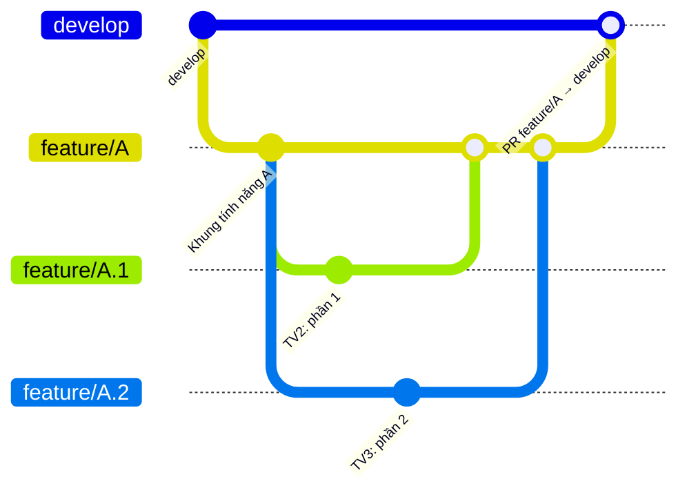
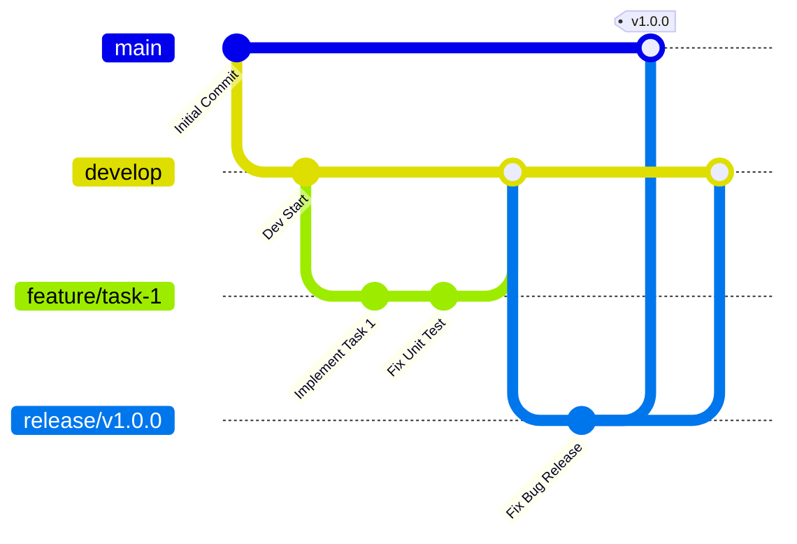

# UTCI-VISION — Quy ước làm việc với Git

| Thuộc tính | Giá trị |
|---|---|
| Repo | https://github.com/HoanBuCon/UTCI-Vision |
| Áp dụng | Toàn bộ thành viên (TV1–TV5), mọi loại thay đổi: mã nguồn, cấu hình, notebook, tài liệu |
| Liên quan | 01_TECHSTACK.md §11, Definition of Done trên Trello |

## 1. Nguyên tắc bắt buộc

- **Không push trực tiếp lên nhánh `main`.**
- **Tuyệt đối không commit mã nguồn trực tiếp lên nhánh `develop` hoặc `main`.** Mọi thay đổi đi qua Pull Request (PR).
- Mỗi tính năng mới phải được phát triển trên **một nhánh riêng**, đặt tên theo cấu trúc `feature/<mã-tác-vụ>-<tên-ngắn-gọn>`.
- Viết commit message theo chuẩn **Conventional Commits** (ví dụ: `feat(auth): validate register form inputs`).
- Mở PR về nhánh `develop`, rà soát xung đột (conflict) bằng **rebase** và yêu cầu **Mentor review** trước khi merge.

## 2. Các loại nhánh

| Nhánh | Mục đích | Tách từ | Gộp vào |
|---|---|---|---|
| `main` / `master` | Mã nguồn ổn định nhất, đang chạy trên Production. Chỉ nhận merge từ `release/*` hoặc `hotfix/*` | — | — |
| `develop` | Tích hợp các tính năng đã hoàn thành; nhánh nền tảng để chạy thử nghiệm (Staging/QC) | `main` | — |
| `feature/*` | Phát triển một tính năng riêng lẻ | `develop` | `develop` (qua PR) |
| `docs/*` | Cập nhật hoặc sửa đổi tài liệu | `develop` | `develop` (qua PR) |
| `refactor/*` | Refactor mã nguồn, không đổi hành vi | `develop` | `develop` (qua PR) |
| `fix/*` | Sửa mã nguồn (lỗi phát hiện trong quá trình phát triển) | `develop` | `develop` (qua PR) |
| `release/*` | Chuẩn bị một đợt phát hành: QA test đợt cuối và sửa lỗi nhỏ | `develop` | `main` **và** `develop` |
| `hotfix/*` | Sửa lỗi khẩn cấp trực tiếp từ Production | `main` | `main` **và** `develop` |

### 2.1 Tính năng nhiều người cùng làm

Nếu 2 thành viên trở lên cùng xây dựng một tính năng A:

1. Tạo nhánh chung `feature/A` (tách từ `develop`).
2. Mỗi thành viên tạo nhánh con `feature/A.1`, `feature/A.2`, … tách từ `feature/A`.
3. Các thành viên mở PR gộp nhánh con vào `feature/A`.
4. Khi toàn bộ tính năng A hoàn thành, mở PR gộp `feature/A` vào `develop`.



### 2.2 Đặt tên nhánh

| Loại | Mẫu | Ví dụ |
|---|---|---|
| Tính năng | `feature/<mã-tác-vụ>-<tên-ngắn-gọn>` | `feature/S2-14-detect-image-api` |
| Tính năng nhiều người | `feature/<A>` → `feature/<A>.<n>` | `feature/S3-ocr` → `feature/S3-ocr.1` |
| Tài liệu | `docs/<mã-tác-vụ>-<tên>` | `docs/S2-chuong-2-ly-thuyet` |
| Refactor | `refactor/<tên>` | `refactor/pipeline-components` |
| Sửa lỗi | `fix/<mã-tác-vụ>-<tên>` | `fix/S3-tracking-id-switch` |
| Phát hành | `release/v<major>.<minor>.<patch>` | `release/v1.0.0` |
| Sửa khẩn cấp | `hotfix/<tên>` | `hotfix/ws-stream-crash` |

`<mã-tác-vụ>` lấy theo thẻ Trello: `S<sprint>-<số thứ tự thẻ>` (ví dụ thẻ thứ 14 của Sprint 2 → `S2-14`). Tên ngắn viết thường, không dấu, nối bằng `-`.

## 3. Quy trình phân nhánh (ví dụ)



Các lệnh tương ứng cho một tính năng:

```bash
git checkout develop && git pull
git checkout -b feature/S2-14-detect-image-api
# ... code, commit theo Conventional Commits ...
git fetch origin && git rebase origin/develop     # xử lý conflict trên nhánh của mình
make ci                                           # phải xanh trước khi mở PR
git push -u origin feature/S2-14-detect-image-api # rồi mở PR về develop trên GitHub
```

Sau khi rebase một nhánh đã push, dùng `git push --force-with-lease` (không dùng `--force`), và chỉ trên nhánh của chính mình.

## 4. Commit message — Conventional Commits

Cấu trúc: `<type>(<scope>): <mô tả ngắn>`, mô tả viết ở thể mệnh lệnh, không quá ~72 ký tự.

| Type | Dùng khi | Ví dụ |
|---|---|---|
| `feat` | Thêm tính năng | `feat(api): add /detect/image endpoint` |
| `fix` | Sửa lỗi | `fix(tracking): keep track id when IoU drops` |
| `refactor` | Đổi cấu trúc, không đổi hành vi | `refactor(pipeline): extract Components dataclass` |
| `docs` | Tài liệu | `docs(srs): mark FR-PIPE-07 as changed` |
| `test` | Thêm/sửa test | `test(ocr): cover parse_value units` |
| `data` | Công cụ / quy trình dữ liệu | `data(split): stratify by resolution` |
| `exp` | Cấu hình hoặc kết quả thí nghiệm, registry | `exp(e3): log yolo11s 960 freeze=10` |
| `chore` | Cấu hình, CI, Docker, Makefile, phụ thuộc | `chore(docker): pin nginx 1.31` |

Scope gợi ý theo cấu trúc mã nguồn: `enhance`, `detector`, `tracking`, `verifier`, `ocr`, `pipeline`, `api`, `web`, `data`, `eval`, `notebook`, `docker`, `ci`, `srs`, `report`.

## 5. Pull Request

1. Mở PR về `develop` (hoặc về `feature/A` nếu là nhánh con), tiêu đề theo Conventional Commits.
2. Mô tả PR ghi: link thẻ Trello, mã yêu cầu SRS (`FR-…`), cách kiểm tra, ảnh chụp nếu có thay đổi giao diện.
3. Rebase lên nhánh đích mới nhất để xử lý conflict trước khi yêu cầu review.
4. `make ci` xanh trên máy và CI GitHub xanh.
5. **Mentor review và approve** trước khi merge. Người mở PR không tự merge khi chưa có approve.
6. PR nhỏ (< 400 dòng thay đổi); xoá nhánh sau khi merge.

## 6. Quy định riêng của dự án

- **Không commit**: dataset, trọng số (`*.pt`, `*.joblib`), video, `runs_out/`, `outputs/`, `.env`. Trọng số chia sẻ qua Google Drive / GitHub Release (xem `docs/models.md`).
- **Notebook fine-tune**: chỉ sửa `notebooks/train/_template.py`, rồi `python scripts/build_notebooks.py`. Không sửa tay file `.ipynb` (CI kiểm tra).
- **Không đưa torch/CUDA vào `requirements*.txt`** (ADR-005); thêm thư viện mới phải khoá phiên bản và ghi vào Techstack.
- **Không hard-code cổng / đường dẫn**: cổng ở `.env`, tham số ở `configs/` (ADR-007).
- Kết quả fine-tune / thí nghiệm đưa vào `experiments/registry.csv` qua `scripts/import_run.py` hoặc `scripts/evaluate.py`, commit với type `exp`.
- Thay đổi yêu cầu: tạo thẻ CHANGE-REQ trên Trello và cập nhật SRS (§9) trước khi code.
